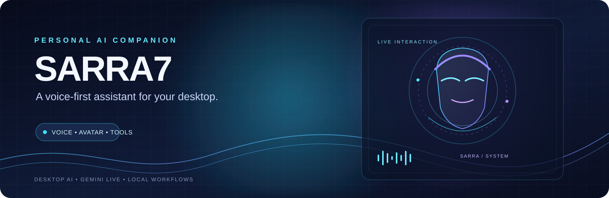

<p align="center">
  
</p>

<h1 align="center">Sarra7</h1>
<p align="center"><strong>A voice-first AI companion for your desktop</strong></p>
<p align="center">
  <a href="https://www.youtube.com/watch?v=Rb-d53cW6qM">Watch the demo</a>
  ·
  <a href="https://github.com/dvdexpresstunisia/Sarra7">Source code</a>
</p>

Sarra7 is a desktop AI assistant built around natural voice interaction, a visual avatar, and a collection of tools that can help users work with their computer. It combines a Python desktop application with Gemini Live, an avatar interface, local memory, and action modules.

> **Project status:** actively evolving. Features, integrations, and platform support can vary by version and configuration. This repository is not a security-audited release.

## What Sarra7 brings together

- **Voice conversation** powered by Gemini Live, with microphone input and spoken responses.
- **Visual avatar** presented alongside the desktop assistant.
- **Voice animation** that responds to the generated audio stream.
- **Action modules** for supported desktop, browser, file, search, and system workflows.
- **Local memory** for selected continuity information between sessions.
- **Mission-oriented workflows** for coordinating supported multi-step actions.
- **Permission and confirmation mechanisms** for actions that require user approval.
- **Optional remote dashboard** components, subject to local configuration.

The exact behavior depends on the tools enabled, installed dependencies, operating system, API access, and configuration. Sarra7 should not be treated as an unattended agent or a guarantee that every action will succeed.

## Architecture at a glance

| Area | Implementation |
|---|---|
| Application entry point | `main.py` |
| Desktop UI and audio | Python, PyQt6, sounddevice, NumPy |
| Live AI conversation | Google Gen AI SDK / Gemini Live |
| Assistant logic and action routing | `core/` |
| Desktop and web tools | `actions/` |
| Memory and configuration | `memory/`, `config/` |
| Avatar resources | `assets/avatar/` |
| Optional dashboard | `dashboard/` |
| Automated tests | `tests/` |

## Requirements

- Python version compatible with the dependencies in [`requirements.txt`](requirements.txt).
- Microphone and audio output for voice interaction.
- A Gemini API key for Gemini-powered features.
- Windows is the primary target for desktop automation; some components may behave differently on other operating systems.
- Chrome or other external applications may be required by specific tools.

## Run locally

From the repository directory, use a virtual environment:

```powershell
python -m venv .venv
.\.venv\Scripts\Activate.ps1
python -m pip install --upgrade pip
pip install -r requirements.txt
python main.py
```

On first launch, follow Sarra7's setup screen to configure the API key and initialize the application. The app uses its local configuration under `config/`; do not publish API keys, OAuth tokens, session files, personal memory, or local certificates.

To run the automated tests:

```powershell
python -m unittest discover -s tests
```

Tests do not replace manual testing with your own microphone, audio devices, browser, API credentials, and desktop environment.

## Demo

[Watch Sarra7 in action on YouTube](https://www.youtube.com/watch?v=Rb-d53cW6qM).

## Privacy and safety notes

Sarra7 may access microphone input, local files, browser content, and system information when the corresponding features are used. Voice data sent to Gemini is processed by Google's service. Local memory and configuration may contain personal information.

Before running or contributing:

- Review the tools in `actions/` and the permissions/confirmation flow.
- Keep credentials and personal data out of Git.
- Avoid using desktop automation on sensitive accounts or important files until you have tested the behavior.
- Review external service policies and the terms applicable to any API or model you use.
- Treat this as an experimental personal assistant, not a security boundary.

## Hackathon and provider integrations

This repository documents the current Sarra7 codebase. **Do not assume that a particular hackathon provider, cloud API, model, or credit program is integrated unless the implementation is present and tested.** For a submission, describe only the integrations actually used by the submitted version and provide a reproducible demo path.

## License and attribution

The repository includes the upstream **MARK LV — JARVIS** license: **Creative Commons Attribution-NonCommercial 4.0 International (CC BY-NC 4.0)**. The license file identifies FatihMakes as the copyright holder. Preserve required attribution and license notices, and review the license before redistributing or using the project commercially.

This README does not change the project's license or grant additional rights to third-party code, models, or assets.

## Contributing

Issues and contributions are welcome. Please include a clear description of the change, steps to reproduce relevant behavior, and tests where practical. Avoid adding credentials, generated bytecode, local state, or personal data to commits.
